# Data Model

**Product:** Behördenbrief Assistant (Web App)
**Document Version:** 0.17
**Status:** Draft
**Last updated:** 2026-11-28

> This document answers **what is stored in the database and how**.
> Product rules: PRD.md · Flows, layers and configuration: ARCHITECTURE.md · Encryption method, keys and GDPR: SECURITY.md · Chunking and embedding model: RAG.md

---

## 1. Conventions

| Topic | Convention |
|---|---|
| Database | Supabase Postgres, schema `public` for all application tables; Supabase's own `auth` schema holds login data |
| Names | Tables and columns in `snake_case`, plural table names, **full words only** (no abbreviations) |
| Primary keys | `uuid`, generated by the database (`gen_random_uuid()`) |
| Human-readable numbers | `customer_number` (`C-000123`) and `transaction_number` (`TX-2026-000123`), generated from database sequences; numbers keep counting across years |
| Time | `timestamptz`, stored in UTC; calendar dates (deadlines, reminder days) as `date` |
| Calendar month for limits | Determined in the `Europe/Berlin` time zone |
| Money | Integer amount in cents (`price_amount_cents = 499`) plus `currency` (`EUR`) |
| Fixed values (status, type) | `text` column with a `CHECK` constraint listing the allowed values (no native Postgres enums) |
| Encrypted columns | Type `bytea`, name ends with `_encrypted`; encrypted and decrypted only in the backend (method: SECURITY.md); never searchable or indexed. Every stored value starts with the **key version** that encrypted it, so keys can be rotated (§5, ARCHITECTURE §11) |
| Standard columns | Every table has `created_at` (default `now()`); every table whose rows can change also has `updated_at`, set automatically by the shared database trigger function `set_updated_at()` on every update. Append-only tables (`letter_pages`, `letter_explanations`, `knowledge_chunks`, `token_usages`, `stripe_events`, `admin_audit_logs`) have only `created_at` |
| Foreign keys | Always indexed; delete behaviour (`CASCADE`, `SET NULL`, `RESTRICT`) stated per relationship (§4) |

## 2. Entity Relationship Diagram

Only keys and relationships are shown; all columns are listed in §3.

```mermaid
erDiagram
    users ||--o{ user_authority_reference_numbers : "has"
    users ||--o{ push_subscriptions : "has"
    users ||--o{ letters : "uploads"
    users ||--o{ transactions : "owns"
    users ||--o{ subscriptions : "has"
    users ||--o{ invoices : "receives"
    users ||--o{ reminders : "receives"
    users ||--o{ admin_audit_logs : "performs (admin)"
    users ||--o{ data_exports : "requests"
    users ||--o{ mcp_access_tokens : "creates (admin)"
    users |o--o| users : "previous account"

    authorities ||--o{ user_authority_reference_numbers : "for"
    authorities ||--o{ knowledge_sources : "has"
    authorities ||--o{ knowledge_chunks : "filters"
    authorities ||--o{ letters : "sent by"
    authorities ||--o{ letters : "recognised by AI"
    authorities ||--o{ transactions : "counted for"

    knowledge_sources ||--o{ knowledge_chunks : "split into"
    knowledge_sources ||--o{ token_usages : "ingestion cost"

    transactions ||--o| letters : "covers"
    transactions ||--o{ token_usages : "records"
    transactions ||--o{ llm_tool_calls : "logs"
    mcp_access_tokens ||--o{ llm_tool_calls : "logs"
    mcp_access_tokens ||--o{ token_usages : "MCP search cost"

    letters ||--o{ letter_pages : "has"
    letters ||--o| letter_explanations : "has"
    letters ||--o| reply_previews : "has"
    letters ||--o{ reply_chat_messages : "has"
    letters ||--o{ reply_documents : "has"
    letters ||--o{ reminders : "triggers"

    plans ||--o{ plan_prices : "priced by"
    plans ||--o{ subscriptions : "used in"
    plan_prices ||--o{ subscriptions : "charged at"
    subscriptions ||--o{ invoices : "billed by"

    users {
        uuid id PK "= auth.users.id"
        text customer_number UK
        text identity_hash UK
        uuid previous_user_id FK
    }
    authorities {
        uuid id PK
    }
    user_authority_reference_numbers {
        uuid id PK
        uuid user_id FK
        uuid authority_id FK
    }
    push_subscriptions {
        uuid id PK
        uuid user_id FK
    }
    knowledge_sources {
        uuid id PK
        uuid authority_id FK
    }
    knowledge_chunks {
        uuid id PK
        uuid knowledge_source_id FK
        uuid authority_id FK
        vector embedding
    }
    transactions {
        uuid id PK
        text transaction_number UK
        uuid user_id FK
        uuid authority_id FK
        uuid letter_id FK
    }
    token_usages {
        uuid id PK
        uuid transaction_id FK
        uuid knowledge_source_id FK
        uuid mcp_access_token_id FK
    }
    letters {
        uuid id PK
        uuid user_id FK
        uuid authority_id FK
        uuid recognised_authority_id FK
    }
    letter_pages {
        uuid id PK
        uuid letter_id FK
    }
    letter_explanations {
        uuid id PK
        uuid letter_id FK
    }
    reply_previews {
        uuid id PK
        uuid letter_id FK
    }
    reply_chat_messages {
        uuid id PK
        uuid letter_id FK
    }
    reply_documents {
        uuid id PK
        uuid letter_id FK
        int version_number
    }
    reminders {
        uuid id PK
        uuid letter_id FK
        uuid user_id FK
    }
    plans {
        uuid id PK
    }
    plan_prices {
        uuid id PK
        uuid plan_id FK
    }
    subscriptions {
        uuid id PK
        uuid user_id FK
        uuid plan_id FK
        uuid plan_price_id FK
    }
    invoices {
        uuid id PK
        uuid user_id FK
        uuid subscription_id FK
    }
    stripe_events {
        text id PK
    }
    application_settings {
        text setting_key PK
    }
    admin_audit_logs {
        uuid id PK
        uuid admin_user_id FK
    }
    data_exports {
        uuid id PK
        uuid user_id FK
    }
    llm_tool_calls {
        uuid id PK
        uuid transaction_id FK
        uuid mcp_access_token_id FK
    }
    mcp_access_tokens {
        uuid id PK
        text token_hash UK
        uuid created_by_admin_user_id FK
    }
```

## 3. Tables

Tables are grouped by the feature module that owns them (ARCHITECTURE §4.3). Only the owning feature's repository reads and writes its tables.

### 3.1 Feature `users`

#### `users`

One row per account. `id` equals the Supabase Auth user id (`auth.users.id`).

| Column | Type | Null | Description |
|---|---|---|---|
| `id` | uuid | no | Primary key; references `auth.users.id` |
| `customer_number` | text | no | `C-000123`; unique; shown in the app and to admin; never printed on letters |
| `email` | text | yes | Copy of the login email (kept in sync with Supabase Auth); unique; used for "Email me", reminders, reactivation code and admin overview; kept after account deletion until identity data is purged |
| `first_name_encrypted` | bytea | yes | First name (required while not purged) |
| `last_name_encrypted` | bytea | yes | Last name (required while not purged) |
| `date_of_birth_encrypted` | bytea | yes | Date of birth (required while not purged) |
| `identity_hash` | text | yes | HMAC of normalised first name + last name + date of birth; unique; used only for the duplicate check (ARCHITECTURE §7.8); `NULL` only on a purged account whose identity moved to a new account |
| `previous_user_id` | uuid | yes | → `users.id`; the purged account of the same person (set when a purged identity registers again); such an account gets **no trial** |
| `address_line_encrypted` | bytea | yes | Street and house number; filled at profile completion |
| `postal_code_encrypted` | bytea | yes | Postal code |
| `city_encrypted` | bytea | yes | City |
| `account_status` | text | no | `registered`, `verified`, `active`, `deleted`, `purged` (identity data removed; only `identity_hash` and ids remain) |
| `role` | text | no | `user`, `admin` (default `user`; changed only by the developer command) |
| `stripe_customer_id` | text | yes | Stripe customer; unique |
| `reminder_email_enabled` | boolean | no | Default `true` |
| `reminder_push_enabled` | boolean | no | Default `false` |
| `reminder_days_before_deadline` | integer[] | no | Default `{7,3,1}`; each value between 1 and 60 |
| `disclaimer_accepted_at` | timestamptz | no | Acceptance at registration |
| `privacy_terms_accepted_at` | timestamptz | no | Acceptance at registration |
| `profile_completed_at` | timestamptz | yes | Set when the address is complete; starts the trial |
| `last_login_at` | timestamptz | yes | Last activity: set by any authenticated request when older than one day (API_DESIGN §2.5); basis for inactivity deletion (PRD H-07) |
| `inactivity_warning_sent_at` | timestamptz | yes | First warning (30 days before deletion) |
| `inactivity_final_warning_sent_at` | timestamptz | yes | Final warning (7 days before deletion) |
| `deleted_at` | timestamptz | yes | Set on account deletion (soft delete) |
| `identity_data_retained_until` | date | yes | Set on deletion: end of the legal retention period of the account's invoices; afterwards email, name and date of birth are purged |
| `created_at`, `updated_at` | timestamptz | no | |

#### `user_authority_reference_numbers`

The user's reference numbers at each authority (e.g., TK insurance number), inserted into replies.

| Column | Type | Null | Description |
|---|---|---|---|
| `id` | uuid | no | Primary key |
| `user_id` | uuid | no | → `users.id` |
| `authority_id` | uuid | no | → `authorities.id` |
| `reference_label` | text | no | Name of the number, e.g. "Versichertennummer" |
| `reference_number_encrypted` | bytea | no | The number itself |
| `created_at`, `updated_at` | timestamptz | no | |

#### `push_subscriptions`

One row per device that allowed push notifications (owned by feature `notifications`).

| Column | Type | Null | Description |
|---|---|---|---|
| `id` | uuid | no | Primary key |
| `user_id` | uuid | no | → `users.id` |
| `endpoint_url` | text | no | Push service endpoint; unique |
| `public_key` | text | no | Browser's public key (p256dh) |
| `authentication_secret` | text | no | Browser's auth secret |
| `device_description` | text | yes | Browser and device, for the user's own overview |
| `last_successful_push_at` | timestamptz | yes | |
| `created_at`, `updated_at` | timestamptz | no | |

### 3.2 Feature `authorities`

#### `authorities`

| Column | Type | Null | Description |
|---|---|---|---|
| `id` | uuid | no | Primary key |
| `display_name` | text | no | E.g. "Techniker Krankenkasse (TK)"; unique |
| `description` | text | yes | Short description shown to users |
| `alternative_names` | text[] | no | Other names that can appear on letters (e.g. "Bundesagentur für Arbeit – Familienkasse", "Kindergeld"); edited by admin; given to the AI by the `list_authorities` tool for recognition (default empty list) |
| `is_active` | boolean | no | Only active authorities are offered to the AI for recognition and to users when they change the authority |
| `created_at`, `updated_at` | timestamptz | no | |

### 3.3 Feature `knowledge`

#### `knowledge_sources`

| Column | Type | Null | Description |
|---|---|---|---|
| `id` | uuid | no | Primary key |
| `authority_id` | uuid | no | → `authorities.id` |
| `source_type` | text | no | `pdf`, `text`, `url` |
| `title` | text | no | Name shown in the admin panel and as source in explanations |
| `source_url` | text | yes | Required when `source_type = url` |
| `storage_path` | text | yes | Required when `source_type = pdf` (private bucket) |
| `text_content` | text | yes | Required when `source_type = text` (public official information, not encrypted) |
| `content_hash` | text | yes | Hash of the last extracted text; unchanged content keeps existing chunks |
| `indexing_status` | text | no | `pending`, `processing`, `indexed`, `failed` |
| `error_code` | text | yes | Set when `failed` |
| `last_indexed_at` | timestamptz | yes | |
| `next_crawl_at` | timestamptz | yes | URL sources only; from the global re-crawl interval |
| `created_at`, `updated_at` | timestamptz | no | |

#### `knowledge_chunks` (vector table)

| Column | Type | Null | Description |
|---|---|---|---|
| `id` | uuid | no | Primary key |
| `knowledge_source_id` | uuid | no | → `knowledge_sources.id` |
| `authority_id` | uuid | no | → `authorities.id`; copied from the source so retrieval can filter without a join |
| `chunk_position` | integer | no | Order of the chunk inside the source |
| `content` | text | no | Chunk text (public official information) |
| `embedding` | vector(768) | no | Embedding of chunk header + `content` (RAG §5.3); dimension = `EMBEDDING_DIMENSION` (§6) |
| `content_search_vector` | tsvector | no | Generated column: `to_tsvector('german', content)`; used by full-text search (RAG §6) |
| `document_url` | text | yes | Exact document the chunk came from: the page URL or a linked PDF found while crawling (for showing the source) |
| `page_number` | integer | yes | PDF page, for showing the source |
| `section_title` | text | yes | Heading the chunk belongs to, if known |
| `token_count` | integer | no | Size of the chunk |
| `created_at` | timestamptz | no | |

#### `application_settings`

Global settings changed by admin.

| Column | Type | Null | Description |
|---|---|---|---|
| `setting_key` | text | no | Primary key, e.g. `recrawl_interval_days` |
| `setting_value` | jsonb | no | E.g. `30` |
| `created_at`, `updated_at` | timestamptz | no | |

### 3.4 Feature `transactions`

#### `transactions`

| Column | Type | Null | Description |
|---|---|---|---|
| `id` | uuid | no | Primary key |
| `transaction_number` | text | no | `TX-2026-000123`; unique |
| `user_id` | uuid | no | → `users.id` |
| `authority_id` | uuid | yes | → `authorities.id`; `NULL` until the AI has recognised the authority, and stays `NULL` when the letter's authority is not supported; follows the letter's `authority_id` when the user changes it; used for per-authority limits and admin statistics |
| `letter_id` | uuid | yes | → `letters.id`; becomes `NULL` when the user deletes the letter |
| `transaction_status` | text | no | `started`, `completed`, `failed` (letter failed with a retryable error; not counted towards the monthly limit, API_DESIGN §4.5) |
| `started_at` | timestamptz | no | Upload time; decides the calendar month for limits |
| `completed_at` | timestamptz | yes | First download or email of a version |
| `created_at`, `updated_at` | timestamptz | no | |

#### `token_usages`

One row per LLM or embedding call. User costs are summed per transaction; knowledge ingestion costs have no transaction and are summed separately for the admin statistics.

| Column | Type | Null | Description |
|---|---|---|---|
| `id` | uuid | no | Primary key |
| `transaction_id` | uuid | yes | → `transactions.id`; required for every operation except `knowledge_ingestion` |
| `knowledge_source_id` | uuid | yes | → `knowledge_sources.id`; set for `knowledge_ingestion` (becomes `NULL` if the source is deleted) |
| `mcp_access_token_id` | uuid | yes | → `mcp_access_tokens.id`; set for `mcp_query` rows of MCP requests over HTTP; `NULL` for the local MCP command and all other rows |
| `operation_type` | text | no | `letter_reading`, `authority_recognition`, `explanation`, `reply_preview`, `chat_answer`, `german_letter`, `retrieval_query`, `knowledge_ingestion`, `mcp_query` (query embedding of an MCP search) |
| `provider_name` | text | no | LLM provider used |
| `model_name` | text | no | Model used |
| `used_fallback` | boolean | no | `true` if the fallback model answered |
| `prompt_version` | text | yes | Prompt file version used, e.g. `explanation_v1` (RAG §7.1); `NULL` for embeddings |
| `tool_round_number` | smallint | yes | Round of the tool-calling loop for this model call (1, 2, …, at most `LLM_MAX_TOOL_ROUNDS`); `NULL` for steps without tools (ARCHITECTURE §7.11) |
| `input_tokens` | integer | no | |
| `output_tokens` | integer | no | |
| `created_at` | timestamptz | no | |

#### `llm_tool_calls`

One row per tool call, made by our own LLM steps or through the MCP server (ARCHITECTURE §7.11–§7.12). It stores **no tool input and no tool result**, only what is needed for debugging, evaluation and statistics. Kept for 1 year.

| Column | Type | Null | Description |
|---|---|---|---|
| `id` | uuid | no | Primary key |
| `caller_type` | text | no | `application` (our own LLM step), `mcp_http`, `mcp_local` |
| `transaction_id` | uuid | yes | → `transactions.id`; required for `application` |
| `mcp_access_token_id` | uuid | yes | → `mcp_access_tokens.id`; required for `mcp_http`; `NULL` for `mcp_local` (local, no token) |
| `operation_type` | text | yes | For `application`: the step, `authority_recognition` or `chat_answer`; `NULL` for MCP |
| `tool_name` | text | no | E.g. `list_authorities`, `search_official_sources` |
| `round_number` | smallint | yes | Round of the tool-calling loop (`application` only) |
| `succeeded` | boolean | no | `false` if the tool returned an error result |
| `error_code` | text | yes | Error code of a failed call (e.g. `invalid_tool_input`, `unknown_tool`, `not_found`) |
| `duration_milliseconds` | integer | no | Time the tool took |
| `created_at` | timestamptz | no | |

### 3.5 Feature `letters`

#### `letters`

| Column | Type | Null | Description |
|---|---|---|---|
| `id` | uuid | no | Primary key |
| `user_id` | uuid | no | → `users.id` |
| `authority_id` | uuid | yes | → `authorities.id`; the authority in use: the recognised one, or the one the user changed it to (PRD E-09); `NULL` until recognition and when the authority is not supported |
| `recognised_authority_id` | uuid | yes | → `authorities.id`; the authority the AI recognised; never changed afterwards, so wrong recognitions can be counted without reading any letter |
| `authority_recognition_confidence` | text | yes | `high` or `low` from the AI (RAG §7.9); `low` shows a note asking the user to check the authority; `NULL` until recognition and when not supported |
| `authority_changed_by_user_at` | timestamptz | yes | When the user last changed the authority |
| `processing_status` | text | no | `queued`, `processing`, `ready`, `failed` (common status model, ARCHITECTURE §7.9) |
| `processing_step` | text | yes | While `processing`: `scanning`, `reading`, `analysing` |
| `error_code` | text | yes | Set when `failed`, e.g. `malware_detected`, `letter_unreadable`, `authority_not_supported`, `transaction_limit_reached` (per-authority limit after recognition), `invalid_llm_output`, `llm_unavailable` (API_DESIGN §3.4) |
| `extracted_text_encrypted` | bytea | yes | Full text read from the pages |
| `recipient_address_encrypted` | bytea | yes | Sender address of the authority office, extracted from the letter; editable by the user; used as recipient of the reply |
| `extracted_deadline` | date | yes | Deadline found in the letter by the AI |
| `user_deadline` | date | yes | Deadline corrected or added by the user; takes precedence |
| `reply_needed` | boolean | yes | From the explanation |
| `letter_date` | date | yes | Date of the letter, extracted by the AI (RAG §7.5); used for the deadline check and "Ihr Schreiben vom" |
| `authority_file_reference_encrypted` | bytea | yes | The authority's file reference (Aktenzeichen) from the letter; editable by the user with the recipient address (PRD R-03) |
| `authority_contact_encrypted` | bytea | yes | Phone, email and contact person from the letter (JSON before encryption); shown with the uncertainty message (RAG §8.2) |
| `search_queries_encrypted` | bytea | yes | Validated German search queries (JSON before encryption); reused when chunks are gone (RAG §6.2) |
| `created_at`, `updated_at` | timestamptz | no | |

The effective deadline is `COALESCE(user_deadline, extracted_deadline)`.

#### `letter_pages`

| Column | Type | Null | Description |
|---|---|---|---|
| `id` | uuid | no | Primary key |
| `letter_id` | uuid | no | → `letters.id` |
| `page_number` | integer | no | Order chosen by the user |
| `storage_path` | text | no | Encrypted image or PDF in the private bucket (SECURITY §5.2) |
| `content_type` | text | no | `image/jpeg`, `image/png`, `image/heic`, `application/pdf` |
| `created_at` | timestamptz | no | |

#### `letter_explanations`

| Column | Type | Null | Description |
|---|---|---|---|
| `id` | uuid | no | Primary key |
| `letter_id` | uuid | no | → `letters.id`; unique (one explanation per letter) |
| `summary_encrypted` | bytea | no | Bengali summary |
| `required_actions_encrypted` | bytea | no | Bengali list of actions (JSON before encryption) |
| `uncertainty_note_encrypted` | bytea | yes | "I am not sure" message, if any |
| `confidence_level` | text | no | `high`, `medium`, `low` |
| `source_references` | jsonb | no | Knowledge chunk ids, source titles and URLs used (public information) |
| `reply_needed_reason_encrypted` | bytea | yes | Bengali reason why a reply is or is not needed (RAG §7.5) |
| `is_uncertain` | boolean | no | `true` when retrieval was weak, confidence is `low` or readability is `poor` (RAG §8.2) |
| `official_sources_found` | boolean | no | `false` when retrieval was weak (no relevant official source); the app then shows its fixed "nothing found" sentence (RAG §8.2) |
| `created_at` | timestamptz | no | |

### 3.6 Feature `replies`

#### `reply_previews`

| Column | Type | Null | Description |
|---|---|---|---|
| `id` | uuid | no | Primary key |
| `letter_id` | uuid | no | → `letters.id`; unique (one preview per letter) |
| `bengali_preview_encrypted` | bytea | yes | Current Bengali reply preview |
| `open_questions_encrypted` | bytea | yes | Information the user should still add (JSON list before encryption, RAG §7.5) |
| `generation_status` | text | no | `queued`, `processing`, `ready`, `failed` |
| `error_code` | text | yes | |
| `created_at`, `updated_at` | timestamptz | no | |

#### `reply_chat_messages`

| Column | Type | Null | Description |
|---|---|---|---|
| `id` | uuid | no | Primary key |
| `letter_id` | uuid | no | → `letters.id` |
| `sender_role` | text | no | `user`, `assistant` |
| `message_text_encrypted` | bytea | yes | Message; `NULL` while an assistant answer is still being generated |
| `processing_status` | text | no | `ready` for user messages; `queued`, `processing`, `ready`, `failed` for assistant answers |
| `preview_was_updated` | boolean | no | `true` if this answer changed the Bengali preview (through the `update_reply_preview` tool) |
| `answer_basis` | text | yes | Assistant answers: `official_sources`, `letter`, `both`, `not_found` (RAG §7.5); `NULL` for user messages and unfinished answers |
| `source_references` | jsonb | no | Assistant answers: knowledge chunk ids, source titles and URLs used (public information); empty list otherwise |
| `created_at`, `updated_at` | timestamptz | no | |

#### `reply_documents`

Holds both the single current **draft** and all **locked versions** of a letter's reply.

| Column | Type | Null | Description |
|---|---|---|---|
| `id` | uuid | no | Primary key |
| `letter_id` | uuid | no | → `letters.id` |
| `document_status` | text | no | `draft`, `locked`, `sent` |
| `version_number` | integer | yes | `NULL` for the draft; 1, 2, 3 … when locked |
| `generation_status` | text | no | `queued`, `processing`, `ready`, `failed` |
| `error_code` | text | yes | |
| `german_text_encrypted` | bytea | yes | German letter text |
| `pdf_storage_path` | text | yes | Encrypted PDF in the private bucket |
| `delivery_method` | text | yes | `download`, `email` (how the version was locked) |
| `generation_requested_at` | timestamptz | yes | When the current generation was requested; the draft is outdated if the preview changed later (API_DESIGN §4.6) |
| `locked_at` | timestamptz | yes | |
| `downloaded_at` | timestamptz | yes | Last download |
| `emailed_at` | timestamptz | yes | Last successful email |
| `email_delivery_status` | text | yes | For "Email me" and "send again": `queued`, `sent`, `failed` (retried by the task) |
| `sent_on` | date | yes | Sending date entered by the user |
| `created_at`, `updated_at` | timestamptz | no | |

### 3.7 Feature `notifications`

#### `reminders`

| Column | Type | Null | Description |
|---|---|---|---|
| `id` | uuid | no | Primary key |
| `letter_id` | uuid | no | → `letters.id` |
| `user_id` | uuid | no | → `users.id` |
| `remind_on` | date | no | Day the reminder is sent |
| `reminder_status` | text | no | `scheduled`, `sent`, `canceled` |
| `sent_at` | timestamptz | yes | |
| `created_at`, `updated_at` | timestamptz | no | |

(`push_subscriptions`: see §3.1, owned by this feature.)

### 3.8 Feature `billing`

#### `plans`

| Column | Type | Null | Description |
|---|---|---|---|
| `id` | uuid | no | Primary key |
| `display_name` | text | no | E.g. "Free trial", "Monthly" |
| `plan_type` | text | no | `trial`, `paid` |
| `trial_duration_days` | integer | yes | Required for `trial` plans |
| `transaction_limit` | integer | no | Transactions per calendar month |
| `limit_scope` | text | no | `per_authority`, `total` |
| `chat_message_limit_per_letter` | integer | no | Maximum user chat messages per letter |
| `stripe_product_id` | text | yes | Filled for `paid` plans by the worker task `create_missing_stripe_prices` |
| `is_active` | boolean | no | Only one active `trial` plan at a time |
| `created_at`, `updated_at` | timestamptz | no | |

#### `plan_prices`

A new row is created whenever admin changes the price; existing subscriptions keep their old price.

| Column | Type | Null | Description |
|---|---|---|---|
| `id` | uuid | no | Primary key |
| `plan_id` | uuid | no | → `plans.id` |
| `price_amount_cents` | integer | no | E.g. `499` |
| `currency` | text | no | `EUR` |
| `stripe_price_id` | text | yes | Unique; filled by the worker task `create_missing_stripe_prices` |
| `stripe_sync_status` | text | no | `pending`, `synced`, `failed`; a price is offered to new subscribers only when `synced` |
| `is_current` | boolean | no | Only one current price per plan; used for new subscriptions |
| `created_at` | timestamptz | no | |

#### `subscriptions`

Trial and paid periods of a user.

| Column | Type | Null | Description |
|---|---|---|---|
| `id` | uuid | no | Primary key |
| `user_id` | uuid | no | → `users.id` |
| `plan_id` | uuid | no | → `plans.id` |
| `plan_price_id` | uuid | yes | → `plan_prices.id`; `NULL` for the trial |
| `is_trial` | boolean | no | |
| `subscription_status` | text | no | `trialing`, `active`, `past_due`, `canceled`, `expired` |
| `stripe_subscription_id` | text | yes | Unique; `NULL` for the trial |
| `payment_method_type` | text | yes | `visa`, `mastercard`, `paypal`, `sepa_debit` (type only) |
| `current_period_start` | timestamptz | no | |
| `current_period_end` | timestamptz | no | Trial end or paid period end |
| `canceled_at` | timestamptz | yes | |
| `trial_ending_email_sent_at` | timestamptz | yes | Trial only; prevents a second trial-ending email |
| `created_at`, `updated_at` | timestamptz | no | |

#### `invoices`

| Column | Type | Null | Description |
|---|---|---|---|
| `id` | uuid | no | Primary key |
| `user_id` | uuid | no | → `users.id` |
| `subscription_id` | uuid | no | → `subscriptions.id` |
| `stripe_invoice_id` | text | no | Unique |
| `invoice_number` | text | no | Stripe invoice number |
| `amount_cents` | integer | no | |
| `currency` | text | no | |
| `invoice_status` | text | no | `draft`, `open`, `paid`, `uncollectible`, `void` |
| `hosted_invoice_url` | text | yes | Stripe invoice page |
| `invoice_pdf_url` | text | yes | Stripe invoice PDF (downloaded from the subscription page) |
| `issued_at` | timestamptz | no | |
| `paid_at` | timestamptz | yes | |
| `created_at`, `updated_at` | timestamptz | no | |

#### `stripe_events`

Makes webhook processing idempotent.

| Column | Type | Null | Description |
|---|---|---|---|
| `id` | text | no | Primary key; Stripe event id |
| `event_type` | text | no | E.g. `invoice.paid` |
| `processed_at` | timestamptz | no | |
| `created_at` | timestamptz | no | |

### 3.9 Feature `users` (continued): data exports

#### `data_exports`

| Column | Type | Null | Description |
|---|---|---|---|
| `id` | uuid | no | Primary key |
| `user_id` | uuid | no | → `users.id` |
| `export_status` | text | no | `queued`, `processing`, `ready`, `failed`, `expired` |
| `storage_path` | text | yes | Encrypted ZIP in the `exports` bucket |
| `expires_at` | timestamptz | yes | 7 days after `ready` |
| `error_code` | text | yes | |
| `created_at`, `updated_at` | timestamptz | no | |

### 3.10 Feature `admin`

#### `admin_audit_logs`

Every admin action, including viewing user and billing overviews. Deleted only by the retention job after 2 years.

| Column | Type | Null | Description |
|---|---|---|---|
| `id` | uuid | no | Primary key |
| `admin_user_id` | uuid | no | → `users.id` (the admin) |
| `action_type` | text | no | `create`, `update`, `delete`, `view` |
| `target_table` | text | no | E.g. `plans`, `knowledge_sources`, `users` |
| `target_id` | text | yes | Id of the changed or viewed row; `NULL` for list views |
| `change_details` | jsonb | yes | Changed field names with old and new values for configuration tables; **never** personal data or letter content |
| `created_at` | timestamptz | no | |

### 3.11 Feature `mcp_access`

#### `mcp_access_tokens`

Access tokens for external AI clients that use the MCP server over HTTP (PRD AD-14, MC-05). The token itself is shown to admin only once, at creation; only its hash is stored. Tokens are never deleted, only revoked, so that the tool-call log keeps its link.

| Column | Type | Null | Description |
|---|---|---|---|
| `id` | uuid | no | Primary key |
| `partner_name` | text | no | Who the token is for, e.g. "Beratungsstelle Frankfurt" (no personal data of users) |
| `token_hash` | text | no | SHA-256 of the token (hex); unique |
| `token_prefix` | text | no | First 8 characters of the token, shown in the admin list to recognise it |
| `expires_at` | timestamptz | yes | Optional end date set by admin; `NULL` = valid until revoked |
| `revoked_at` | timestamptz | yes | Set when admin revokes the token |
| `last_used_at` | timestamptz | yes | Last accepted MCP request |
| `created_by_admin_user_id` | uuid | no | → `users.id` (the admin) |
| `created_at`, `updated_at` | timestamptz | no | |

A token is valid when `revoked_at IS NULL` and (`expires_at IS NULL` or `expires_at > now()`).

## 4. Relationships

| From | To | Cardinality | On delete of parent |
|---|---|---|---|
| `users.id` | `auth.users.id` | 1 : 1 | Same value, **no foreign key constraint**: a purged account outlives its Supabase Auth user (the Auth user is disabled on deletion and removed on purge) |
| `users.previous_user_id` | `users.id` | 0..1 : 0..1 | `RESTRICT` |
| `user_authority_reference_numbers.user_id` | `users.id` | n : 1 | `CASCADE` |
| `user_authority_reference_numbers.authority_id` | `authorities.id` | n : 1 | `RESTRICT` |
| `push_subscriptions.user_id` | `users.id` | n : 1 | `CASCADE` |
| `knowledge_sources.authority_id` | `authorities.id` | n : 1 | `RESTRICT` |
| `knowledge_chunks.knowledge_source_id` | `knowledge_sources.id` | n : 1 | `CASCADE` |
| `knowledge_chunks.authority_id` | `authorities.id` | n : 1 | `RESTRICT` |
| `transactions.user_id` | `users.id` | n : 1 | `RESTRICT` |
| `transactions.authority_id` | `authorities.id` | n : 1 | `RESTRICT` |
| `transactions.letter_id` | `letters.id` | 1 : 0..1 (unique) | `SET NULL` |
| `token_usages.transaction_id` | `transactions.id` | n : 1 | `RESTRICT` |
| `token_usages.knowledge_source_id` | `knowledge_sources.id` | n : 1 | `SET NULL` |
| `token_usages.mcp_access_token_id` | `mcp_access_tokens.id` | n : 1 | `RESTRICT` |
| `llm_tool_calls.transaction_id` | `transactions.id` | n : 1 | `RESTRICT` |
| `llm_tool_calls.mcp_access_token_id` | `mcp_access_tokens.id` | n : 1 | `RESTRICT` |
| `mcp_access_tokens.created_by_admin_user_id` | `users.id` | n : 1 | `RESTRICT` |
| `admin_audit_logs.admin_user_id` | `users.id` | n : 1 | `RESTRICT` |
| `data_exports.user_id` | `users.id` | n : 1 | `CASCADE` |
| `letters.user_id` | `users.id` | n : 1 | `RESTRICT` |
| `letters.authority_id` | `authorities.id` | n : 1 | `RESTRICT` |
| `letters.recognised_authority_id` | `authorities.id` | n : 1 | `RESTRICT` |
| `letter_pages.letter_id` | `letters.id` | n : 1 | `CASCADE` |
| `letter_explanations.letter_id` | `letters.id` | 1 : 0..1 | `CASCADE` |
| `reply_previews.letter_id` | `letters.id` | 1 : 0..1 | `CASCADE` |
| `reply_chat_messages.letter_id` | `letters.id` | n : 1 | `CASCADE` |
| `reply_documents.letter_id` | `letters.id` | n : 1 | `CASCADE` |
| `reminders.letter_id` | `letters.id` | n : 1 | `CASCADE` |
| `reminders.user_id` | `users.id` | n : 1 | `CASCADE` |
| `plan_prices.plan_id` | `plans.id` | n : 1 | `RESTRICT` |
| `subscriptions.user_id` | `users.id` | n : 1 | `RESTRICT` |
| `subscriptions.plan_id` | `plans.id` | n : 1 | `RESTRICT` |
| `subscriptions.plan_price_id` | `plan_prices.id` | n : 1 | `RESTRICT` |
| `invoices.user_id` | `users.id` | n : 1 | `RESTRICT` |
| `invoices.subscription_id` | `subscriptions.id` | n : 1 | `RESTRICT` |

Deleting a letter therefore removes its pages, explanation, preview, chat, reply documents and reminders in one step, while the transaction and its token usages stay. Stored files are removed by the `delete_letter_files` task (ARCHITECTURE §7.4).

## 5. Business Rules

| Rule (PRD reference) | Enforced by |
|---|---|
| One account per person: `identity_hash` is unique (A-07) | Unique constraint; duplicate check in `users.service` |
| Changing first name, last name or date of birth recomputes `identity_hash` and runs the duplicate check again; a match blocks the change | `users.service` |
| The duplicate check never returns an email address (A-07) | `users.service`; API tests |
| Trial starts only after profile completion and only once per account (A-09, B-01) | Partial unique index: one `subscriptions` row with `is_trial = true` per `user_id`; `billing.service` |
| An account with `previous_user_id` never gets a trial | `billing.service` |
| A trial needs an active trial plan (created by the seed command, §12) | `billing.service` (no active trial plan → no trial, logged) |
| Seed data never overwrites existing rows; admin changes are kept | Seed command inserts only missing rows (§12) |
| Only one active trial plan and one current price per plan (AD-11) | Partial unique indexes |
| Price change creates a new `plan_prices` row; existing subscriptions keep their price (AD-11) | `billing.service`; rows in `plan_prices` are never updated except `is_current`, `stripe_price_id` and `stripe_sync_status` |
| A paid plan can be subscribed to only when its current price is `synced` with Stripe | `billing.service` |
| Encrypted values are written with the current key version; older versions stay readable until the re-encryption task has converted them | Encryption helper in `core/`; `reencrypt_with_current_key` task (ARCHITECTURE §4.3) |
| Account is read-only when no subscription is `trialing` or `active` (B-09) | `billing.service` |
| Monthly limit counts transactions with `transaction_status` `started` or `completed` by `started_at` in the current calendar month (Europe/Berlin), per authority or in total depending on `plans.limit_scope` (B-07, B-08); `failed` transactions are not counted. The total limit is checked at upload; the per-authority limit is checked after the authority is recognised and again when the user changes it, counting by `transactions.authority_id` | `transactions.service`; index §7 |
| The AI recognises the authority only among active authorities; `recognised_authority_id` is set once and never changed (E-09, AI-03) | `letters.service` |
| No supported authority recognised → letter `failed` with `authority_not_supported` (not retryable), `authority_id` stays `NULL`, transaction `failed` (not counted) (E-10) | `letters.service`, `transactions.service` |
| Per-authority limit reached after recognition → letter `failed` with `transaction_limit_reached`, transaction `failed` (not counted) (B-07) | `letters.service`, `transactions.service` |
| The user can change the authority of a `ready` letter, or of a letter `failed` with `authority_not_supported`, to another active authority unless a reply version is locked; the change sets `authority_id` and `authority_changed_by_user_at`, moves `transactions.authority_id` to the new authority, deletes the preview, chat messages, draft and scheduled reminders, and creates the explanation again in the same transaction (E-09) | `letters.service` → `replies.service`, `notifications.service`, `transactions.service` |
| MCP access tokens: only the SHA-256 hash is stored; the token is shown once; revoked or expired tokens are refused; tokens are never deleted (AD-14, MC-05) | `mcp_access.service`; no delete method in the repository |
| Tool calls are logged without input or result; `application` calls need a transaction, `mcp_http` calls need a token, `mcp_local` calls have neither | `CHECK` on `llm_tool_calls` (`caller_type` with the matching columns); tool-calling loop and `mcp_server` |
| Tool calls are kept 1 year | Trigger rejects `DELETE` of rows younger than 1 year; retention job `purge_old_tool_calls` |
| Chat limit: user messages per letter ≤ `plans.chat_message_limit_per_letter` (R-12) | `replies.service` |
| Transactions, token usages and invoices are never deleted | Database trigger rejects `DELETE`; no delete method in repositories |
| Admin audit logs (2 years) and Stripe events (1 year) are deleted only by retention jobs, never earlier | Trigger rejects `DELETE` of rows younger than the retention period; retention jobs (ARCHITECTURE §7.10) |
| Retention rules (SECURITY §16.4): inactivity deletion after 3 years without login with two warnings; identity data purged after `identity_data_retained_until`; data exports expire after 7 days | Scheduled jobs in `users` and maintenance tasks |
| Purging identity data sets `account_status = purged`, clears email, name and date of birth, keeps `identity_hash`, deletes the Supabase Auth user | `users.service` |
| Registration matching a **purged** account: a new account is created without trial; the `identity_hash` moves from the purged row to the new row (purged row: `NULL`), and the new row stores `previous_user_id` | `users.service` (one database transaction) |
| A token usage belongs to a transaction, except `knowledge_ingestion` and `mcp_query` (MCP searches are linked to the MCP access token when there is one) | `CHECK (transaction_id IS NOT NULL OR operation_type IN ('knowledge_ingestion', 'mcp_query'))` |
| Every admin action is written to `admin_audit_logs` in the same database transaction (AD-13) | `admin` service and the services called by admin routes |
| One transaction per letter | Unique `transactions.letter_id` |
| At most one draft per letter (R-05) | Partial unique index on `reply_documents(letter_id)` where `document_status = 'draft'` |
| Draft has no version number; locked and sent documents have one (R-08) | `CHECK ((document_status = 'draft') = (version_number IS NULL))` |
| Version numbers are unique per letter and assigned only on lock: v1, v2, … (R-08) | Unique index on `(letter_id, version_number)`; `replies.service` assigns `MAX + 1` inside the locking transaction |
| A locked document's text and PDF never change; only `locked → sent`, `sent_on`, `downloaded_at` and `emailed_at` may change (R-06, R-07, R-09) | Database trigger rejecting other updates; `replies.service` |
| The German letter is never edited directly; a new generation replaces the draft (R-05) | No API to edit German text; `replies.service` |
| Effective deadline = `user_deadline` if set, otherwise `extracted_deadline`; changing it reschedules reminders (E-07) | `letters.service` → `notifications.service` |
| Changing the reminder days in the settings cancels the scheduled reminders of all open deadlines and creates new ones (N-03) | `users.service` → `notifications.service` |
| Reminders for deadlines in the past are canceled | `send_due_reminders` |
| Reminders are unique per letter and day; sent only once | Unique index `(letter_id, remind_on)`; `reminder_status` |
| Deleting a letter is permanent; the transaction keeps its tokens and dates (H-04) | Relationships §4; `delete_letter_files` |
| Account deletion is a soft delete: `account_status = deleted`, `deleted_at` set; letters, address, reference numbers and push subscriptions deleted; email, name, date of birth and `identity_hash` kept (H-05) | `users.service` |
| A deleted account can be reactivated without a new trial (A-10) | `users.service`; trial index above |
| Admin views never read encrypted letter, explanation, preview, chat or reply columns (AD-10) | `admin` feature uses only its own read-only queries; API tests |
| Admin user overview shows customer number, email and name (AD-08) | `admin` feature (name decrypted only for this view) |
| Stripe events are processed once | `stripe_events.id` primary key |

## 6. Vector Table

| Item | Value |
|---|---|
| Extension | `pgvector` (`CREATE EXTENSION vector`), enabled in the first migration |
| Table | `knowledge_chunks` |
| Column | `embedding vector(N)` |
| Dimension | **768** (`text-multilingual-embedding-002`, RAG §2); equals `EMBEDDING_DIMENSION` |
| Distance | Cosine distance (`<=>`) |
| Index | **HNSW** on `embedding` with `vector_cosine_ops`, `m = 16`, `ef_construction = 64` (RAG §6) |
| Full-text | `content_search_vector` (German) with a **GIN** index, combined with vector search (RAG §6) |
| Filter | `authority_id` (B-tree index) is applied together with the vector search |
| Changing the model or dimension | New migration changes the column type, rebuilds the index, and all sources are re-indexed |

## 7. Indexes

Primary keys and unique constraints create their own indexes. Additional indexes:

| Table | Columns | Purpose |
|---|---|---|
| `users` | `identity_hash` (unique); `previous_user_id` | Duplicate check; trial rule |
| `users` | `customer_number` (unique), `stripe_customer_id` (unique) | Lookup |
| `users` | `email` (unique); `last_login_at`; `identity_data_retained_until` (partial, deleted accounts) | Admin search and sync; inactivity job; purge job |
| `data_exports` | `(user_id, created_at)`; `expires_at` | Export list; expiry job |
| `user_authority_reference_numbers` | `(user_id, authority_id)` (unique: one number per authority) | Reply generation; fills `{{REFERENCE_NUMBER}}` (RAG §7.6) |
| `push_subscriptions` | `user_id` | Sending reminders |
| `knowledge_sources` | `authority_id`; `next_crawl_at` (partial, URL sources) | Admin list; due re-crawls |
| `knowledge_chunks` | `knowledge_source_id`; `authority_id`; HNSW on `embedding`; GIN on `content_search_vector` | Re-index; vector and full-text retrieval |
| `transactions` | `(user_id, started_at)`; `(user_id, authority_id, started_at)` | Monthly limits (total, per authority) |
| `transactions` | `letter_id` (unique); `started_at` | Letter link; admin statistics |
| `token_usages` | `transaction_id`; `knowledge_source_id`; `mcp_access_token_id`; `(operation_type, created_at)` | Token totals; ingestion cost; MCP cost per token; admin statistics |
| `admin_audit_logs` | `(admin_user_id, created_at)`; `(target_table, target_id)` | Audit review |
| `letters` | `(user_id, created_at)`; `recognised_authority_id`; `authority_id` | History; recognition statistics |
| `llm_tool_calls` | `transaction_id`; `(mcp_access_token_id, created_at)`; `(tool_name, created_at)`; `created_at` | Debugging per transaction; MCP usage per token; statistics; retention job |
| `mcp_access_tokens` | `token_hash` (unique) | Token check on every MCP request |
| `letter_pages` | `(letter_id, page_number)` (unique) | Page order |
| `reply_chat_messages` | `(letter_id, created_at)` | Chat display; chat limit count |
| `reply_documents` | `(letter_id)` partial where draft (unique); `(letter_id, version_number)` (unique) | Draft and version rules |
| `reminders` | `(remind_on, reminder_status)`; `(letter_id, remind_on)` (unique) | Daily reminder job; no duplicates |
| `subscriptions` | `(subscription_status, current_period_end)` for trial jobs; `(user_id, subscription_status)`; `user_id` partial where `is_trial` (unique); `stripe_subscription_id` (unique) | Read-only check; one trial; webhooks |
| `plans` | partial unique where `plan_type = 'trial' AND is_active` | One active trial plan |
| `plan_prices` | `(plan_id)` partial where `is_current` (unique); `stripe_price_id` (unique); `stripe_sync_status` partial where `pending` | Current price; Stripe sync job |
| `invoices` | `(user_id, issued_at)`; `stripe_invoice_id` (unique) | Subscription page; webhooks |

## 8. RLS Policies

The frontend never accesses the database (ARCHITECTURE §1). RLS is a second line of defence that blocks Supabase's public API roles.

| Rule | Detail |
|---|---|
| RLS enabled on every table in `public` | Done in the migration that creates the table |
| No policies for `anon` and `authenticated` | Without a policy, these roles can read or write nothing (deny-all) |
| Table privileges for `anon` and `authenticated` revoked | Additional protection against the Supabase Data API |
| Backend access | The backend (API and worker) connects through `DATABASE_URL` with a dedicated server-side database role that is not subject to these restrictions; the exact role setup is confirmed in Supabase docs |
| Authorization | Which user may see which row is decided in the service layer (every query filters by the current user); covered by API tests (other user's resource → 404) |

Storage bucket access rules: SECURITY.md.

## 9. Migrations

| Topic | Rule |
|---|---|
| Tool | Alembic with the async engine; migration files in `server_side/migrations/` |
| Supabase CLI | Its migration folder (`supabase/migrations/`) is not used; Alembic is the only migration tool (MEMORY D-039) |
| Creation | Generated with Alembic autogenerate from the SQLAlchemy models, then **reviewed and completed by hand** (triggers, partial indexes, CHECK constraints, RLS statements, extensions) |
| File names | Alembic revision id plus a descriptive name in full words, e.g. `add_reply_documents_table` |
| Downgrade | **Every migration has a working downgrade** |
| Testing | Integration tests run upgrade to head, downgrade to base and upgrade again on `behoerdenbrief_assistant_webapp_testdb` (local, and in CI the Supabase database container) |
| Applied migrations | Never edited; corrections are new migrations |
| Backward compatibility | Migrations run before the new code is deployed (ARCHITECTURE §13.3), so each migration must work with the currently running code: add first, remove in a later release |
| Production | Applied only by the CI/CD pipeline (`alembic upgrade head` against the production database) |
| Local and test | `alembic upgrade head` against the local development database (`postgres`) or `behoerdenbrief_assistant_webapp_testdb` |
| Initial data | Never inside migrations; created by the seed command (§12) |
| First migration | Enables `pgvector` in the schema `extensions` (created if missing, as in the TestDB), creates the shared trigger function `set_updated_at()` and removes the default rights that the role `postgres` gives `anon`, `authenticated` and `service_role` on new tables, sequences and functions in `public` (T-038, MEMORY D-058). `gen_random_uuid()` is built into Postgres 17, so `pgcrypto` is not needed. The other shared objects (the number sequences, `reject_delete()` and `reject_locked_document_change()`) are created by the first table task that needs them, together with its test. The downgrade never drops the schema `extensions`, because Supabase keeps other extensions there, and never gives the default rights back, because that would open new tables again (MEMORY D-058) |
| Triggers per table | The migration that creates a table also attaches its triggers (`set_updated_at`, and `reject_delete` for append-only tables) |

## 10. ORM Models

One SQLAlchemy model class per table, in the owning feature's `models.py` (ARCHITECTURE §4.2). Class names are singular, in full words.

| Table | Model class | File |
|---|---|---|
| `users` | `User` | `features/users/models.py` |
| `data_exports` | `DataExport` | `features/users/models.py` |
| `user_authority_reference_numbers` | `UserAuthorityReferenceNumber` | `features/users/models.py` |
| `authorities` | `Authority` | `features/authorities/models.py` |
| `knowledge_sources` | `KnowledgeSource` | `features/knowledge/models.py` |
| `knowledge_chunks` | `KnowledgeChunk` | `features/knowledge/models.py` |
| `application_settings` | `ApplicationSetting` | `features/knowledge/models.py` |
| `transactions` | `Transaction` | `features/transactions/models.py` |
| `token_usages` | `TokenUsage` | `features/transactions/models.py` |
| `llm_tool_calls` | `LlmToolCall` | `features/transactions/models.py` |
| `letters` | `Letter` | `features/letters/models.py` |
| `letter_pages` | `LetterPage` | `features/letters/models.py` |
| `letter_explanations` | `LetterExplanation` | `features/letters/models.py` |
| `reply_previews` | `ReplyPreview` | `features/replies/models.py` |
| `reply_chat_messages` | `ReplyChatMessage` | `features/replies/models.py` |
| `reply_documents` | `ReplyDocument` | `features/replies/models.py` |
| `reminders` | `Reminder` | `features/notifications/models.py` |
| `push_subscriptions` | `PushSubscription` | `features/notifications/models.py` |
| `plans` | `Plan` | `features/billing/models.py` |
| `plan_prices` | `PlanPrice` | `features/billing/models.py` |
| `subscriptions` | `Subscription` | `features/billing/models.py` |
| `invoices` | `Invoice` | `features/billing/models.py` |
| `stripe_events` | `StripeEvent` | `features/billing/models.py` |
| `admin_audit_logs` | `AdminAuditLog` | `features/admin/models.py` |
| `mcp_access_tokens` | `McpAccessToken` | `features/mcp_access/models.py` |

Allowed status values are defined once per feature in `constants.py` and match the CHECK constraints. Relationships between models of different features are declared only by foreign key columns; cross-feature access goes through services (ARCHITECTURE §5).

## 11. Status Transitions

Only these transitions are allowed; services reject all others.

| Table.column | Allowed transitions |
|---|---|
| `users.account_status` | `registered → verified → active`; `active → deleted`; `deleted → verified` (reactivation, no trial; the address is entered again); `deleted → purged` (no way back) |
| `data_exports.export_status` | `queued → processing → ready → expired`; `queued → failed`; `processing → failed` |
| `letters.processing_status` | `queued → processing → ready`; `queued → failed`; `processing → failed`; `failed → queued` (retry, only for retryable error codes, API_DESIGN §4.5; not for `authority_not_supported` or `transaction_limit_reached`); `ready → processing` and `failed → processing` for `authority_not_supported` (authority changed by the user, step `analysing`, PRD E-09, E-10) |
| `reply_previews.generation_status`, `reply_chat_messages.processing_status`, `reply_documents.generation_status` | `queued → processing → ready`; `queued → failed`; `processing → failed`; a failed item can be requested again (new `queued`) |
| `reply_documents.document_status` | `draft → locked → sent` (no way back) |
| `reply_documents.email_delivery_status` | `NULL → queued` ("Email me" or first "send again"); `queued → sent`; `queued → failed`; `failed → queued` and `sent → queued` ("send again", API_DESIGN §4.6) |
| `knowledge_sources.indexing_status` | `pending → processing → indexed`; `pending → failed`; `processing → failed`; `indexed → pending` and `failed → pending` (edit or re-crawl) |
| `transactions.transaction_status` | `started → completed` (no way back); `started → failed` (letter failed with a retryable error); `failed → started` (retry, or authority changed by the user) |
| `subscriptions.subscription_status` | `trialing → active` or `expired`; `active → past_due → active`; `active → canceled`; `past_due → canceled` (following Stripe events) |
| `plan_prices.stripe_sync_status` | `pending → synced`; `pending → failed → pending` |
| `reminders.reminder_status` | `scheduled → sent`; `scheduled → canceled` |
| `invoices.invoice_status` | Follows Stripe: `draft → open → paid`; `open → uncollectible → paid`; `draft → void`; `open → void` |

## 12. Seed Data

Initial data comes from a versioned file and a command, not from migrations.

| Topic | Rule |
|---|---|
| File | `server_side/seed/initial_data.yaml` (committed, contains no secrets and no personal data) |
| Command | `python -m app.command_line seed_initial_data` |
| When | Automatically in CI/CD after every production migration, and locally after `alembic upgrade head` (ARCHITECTURE §12.4, §13.3) |
| Idempotent | Inserts only rows that do not exist yet (matched by natural key); never updates or deletes, so changes made by admin are kept |
| Stripe | The seed writes database rows only. Missing Stripe products and prices are created by the worker task `create_missing_stripe_prices` (Stripe keys stay in Render) |
| Crawling | Seeded URL sources get `indexing_status = pending` and `next_crawl_at = now`; the worker's periodic `recrawl_due_sources` job crawls and indexes them (no broker access needed from CI) |

**Content of `initial_data.yaml`**

| Table | Natural key | Values |
|---|---|---|
| `authorities` | `display_name` | The six launch authorities, active, each with its `alternative_names` as listed in RAG §3.1 (PRD §4): Techniker Krankenkasse (TK), Jobcenter, Agentur für Arbeit, Wohngeldstelle, Wohnungsamt, Familienkasse (Kindergeld and Kinderzuschlag) |
| `plans` | `display_name` | **Free trial:** `plan_type = trial`, 30 days, 5 transactions per calendar month, `limit_scope = total`, 20 chat messages per letter, active |
| `plans` + `plan_prices` | `display_name` | **Monthly:** `plan_type = paid`, 15 transactions per calendar month, `limit_scope = total`, 20 chat messages per letter, `499` cents `EUR`, active and current, `stripe_sync_status = pending` |
| `application_settings` | `setting_key` | `recrawl_interval_days = 30` |
| `knowledge_sources` | `source_url` | Official nationwide pages of every launch authority listed in RAG §3.2; `source_type = url`, each with its authority |

Development-only test users are not part of the seed; automated tests create their own data.

## 13. Change Log

| Date | Version | Changes |
|---|---|---|
| 2026-11-19 | 0.1 | First draft from developer decisions: UUID keys, readable customer and transaction numbers, text + CHECK for fixed values, application-level encryption of letter content and personal profile data, HMAC identity hash, deny-all RLS, HNSW vector index, mandatory downgrades, no seed data (admin creates initial data), money in cents, admin sees customer number, email and name |
| 2026-11-19 | 0.2 | Seed data: `initial_data.yaml` and idempotent `seed_initial_data` command run after migrations (TK authority, trial plan 5 / paid plan 15 transactions per month in total, 20 chat messages per letter, €4.99, 30-day re-crawl, TK URL sources); Stripe objects created by the worker; seeded URLs crawled by the periodic job |
| 2026-11-19 | 0.3 | Review against ARCHITECTURE: nullable Stripe ids with `stripe_sync_status` (seed works without Stripe); common letter status model with `processing_step`; unique `users.email` kept after deletion; `email_delivery_status`; `trial_ending_email_sent_at`; `knowledge_chunks.document_url`; ingestion token costs; `admin_audit_logs`; key versions for encryption rotation; `set_updated_at` trigger; rules for reminder-day changes, identity changes and past deadlines; ORM model names; status transitions |
| 2026-11-19 | 0.4 | Aligned with SECURITY 0.1: files encrypted in storage, `scanning` step, `data_exports` table, inactivity and retention columns on `users` (`last_login_at`, warnings, `identity_data_retained_until`, status `purged`), audit log and Stripe event retention, nullable identity columns after purge |
| 2026-11-19 | 0.5 | Final review: `created_at`/`updated_at` made consistent (`push_subscriptions`, `reply_chat_messages`, `application_settings`, `stripe_events`); invoice status transitions; registration of a purged identity (new account without trial, `previous_user_id`, identity hash moves); `users.id` without database foreign key to `auth.users` because purged accounts outlive the Auth user |
| 2026-11-19 | 0.6 | Aligned with RAG 0.1: `vector(768)`, generated German `content_search_vector` with GIN index, HNSW parameters, `token_usages.prompt_version` |
| 2026-11-19 | 0.7 | Aligned with RAG 0.2: `letters.letter_date`, `authority_file_reference_encrypted`, `authority_contact_encrypted`, `search_queries_encrypted` |
| 2026-11-19 | 0.8 | Aligned with DESIGN 0.1: transaction status `failed` (not counted) and letter retry transition, reactivation returns to `verified`, `last_login_at` as daily last activity, `letter_explanations.reply_needed_reason_encrypted` and `is_uncertain`, source URLs in `source_references`, `reply_previews.open_questions_encrypted`, one reference number per authority (unique index) |
| 2026-11-19 | 0.9 | Aligned with DESIGN 0.2: `reply_documents.generation_requested_at` (outdated draft), "send again" transitions of `email_delivery_status` |
| 2026-11-21 | 0.10 | LLM tool calling and MCP (PRD 0.15, ARCHITECTURE 0.22): `authorities.alternative_names`; `letters.authority_id` nullable, `recognised_authority_id`, `authority_changed_by_user_at`, new error codes; `transactions.authority_id` nullable and following the letter; `token_usages.tool_round_number`; new tables `llm_tool_calls` (no content, 1 year) and `mcp_access_tokens` (hash only, optional expiry, never deleted); relationships, business rules (recognition, unsupported authority, per-authority limit after recognition, authority change, tokens, tool-call log), indexes, ORM models, letter status `ready → processing`; seed with six authorities and their sources |
| 2026-11-21 | 0.11 | Aligned with RAG 0.3: `letters.authority_recognition_confidence`; operation type `authority_recognition` (`token_usages`, `llm_tool_calls`); seed refers to RAG §3.1 (other names) and §3.2 (sources) |
| 2026-11-21 | 0.12 | Aligned with DESIGN 0.4: `letter_explanations.official_sources_found`; `reply_chat_messages.answer_basis` and `source_references`; authority change also for a letter failed with `authority_not_supported` (`failed → processing`, transaction `failed → started`) |
| 2026-11-21 | 0.13 | Aligned with RULES 0.4: `llm_tool_calls.caller_type` value `mcp_local` (was `mcp_stdio`); `letters.extracted_deadline` (was `ai_deadline`, naming rule) |
| 2026-11-21 | 0.14 | Final review: `token_usages.mcp_access_token_id` and operation type `mcp_query`, so the embedding cost of MCP searches is recorded (CHECK, relationship, index, ERD) |
| 2026-11-22 | 0.15 | References to the API design document changed to `API_DESIGN.md` and `API_DESIGN §` (MEMORY D-105) |
| 2026-11-26 | 0.16 | §9: TestDB name, local Supabase and CI database container; Supabase CLI migrations not used (MEMORY D-039, D-116) |
| 2026-11-28 | 0.17 | §9: the first migration enables `pgvector` in the schema `extensions`, creates only `set_updated_at()` and removes the default Data API rights in `public`; no `pgcrypto`; other sequences and trigger functions come with the first table task that needs them; the downgrade keeps the schema `extensions` and does not give the rights back (T-038, MEMORY D-058) |
